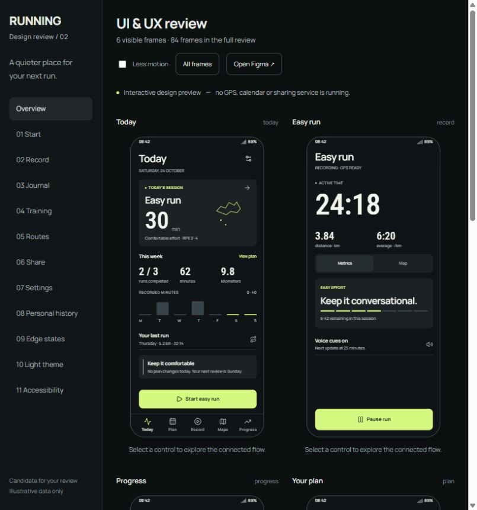
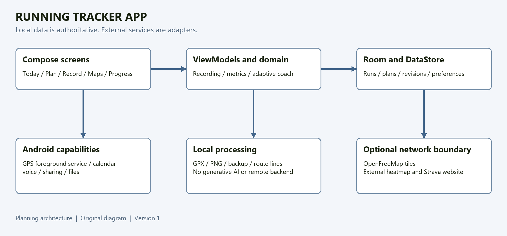
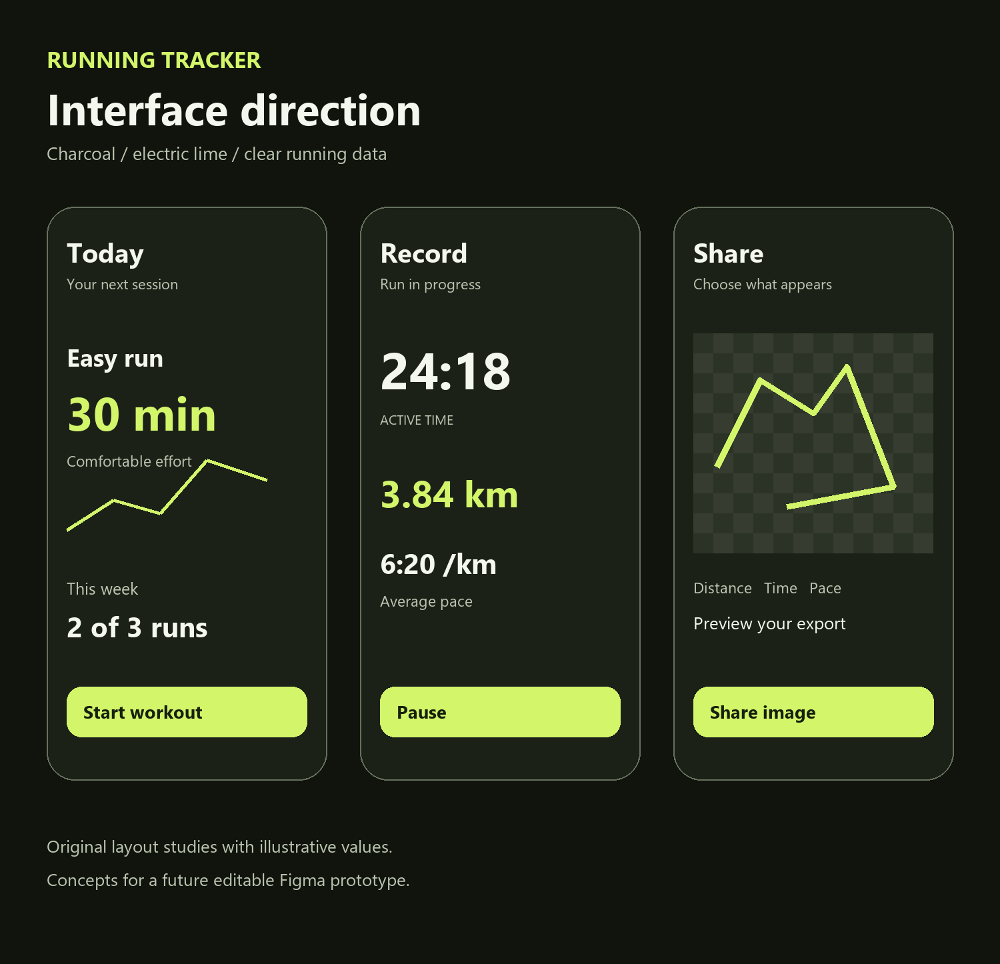

# Running Tracker App

A personal Android running app planned around reliable recording, understandable adaptive training, and ownership of your data.

**Status: architecture documented; a complete browser UI/UX review is ready. The Android application has not been implemented. Figma work is partial.**

## Current design review

[Open the UI/UX review guide](design/review/README.md): 84 candidate mobile frames, interactive flow navigation, light and dark themes, compact and large-text layouts. This is the redesigned direction awaiting owner feedback. The Figma Starter connector quota stopped editing after 31 composed frames; the complete set is available in the local browser review.

## Project direction

Record a run, review meaningful statistics, follow a saved route, and work through a training plan that adjusts through transparent rules. Keep data on the phone and export it when needed. The initial product targets one runner using an existing Android phone and computer, with zero additional spending.

## Documentation

| Document | What it covers |
| --- | --- |
| [System architecture](docs/system-architecture.md) | Framework, local backend, schema, interfaces, recording lifecycle, adaptive policy, integrations, risks and verification |
| [UI and UX design system](docs/design-system.md) | Navigation, charcoal/lime tokens, Roboto typography, icons, components, motion, accessibility, screen flows and Figma handoff |
| [Implementation plan](tasks/plan.md) | Milestones, dependency order and release gates |
| [Implementation checklist](tasks/todo.md) | Small work items with acceptance criteria and verification |
| [Research sources](docs/sources.md) | Official documentation, training research and design references |
| [System architecture report](docs/reports/Running-Tracker-System-Architecture.docx) | Downloadable document using the selected System Design template |
| [Design report](docs/reports/Running-Tracker-Design-Report.docx) | Downloadable document using the selected Design Report template |

## Planned first release

- GPS recording with locked-screen operation, manual pause, splits and interrupted-run recovery.
- Progress analytics with explicit metric definitions and GPS quality indicators.
- Generated plans, manual workout editing, guided intervals and a local adaptive coaching policy.
- Reviewed changes, explanations, history, undo and protected manual workouts.
- Maps, saved-route following, bounded offline areas and external population heatmap access.
- Calendar scheduling through the Android calendar system.
- Customizable share images, true transparent PNG export and Android sharing.
- Manual backup, validated restore and visible backup status.
- GPX export for manual Strava upload, without a paid Strava developer dependency.

## Following release

Personal route heatmaps, GPX history import with duplicate detection, and shoe mileage tracking.

## Proposed stack

Kotlin, Jetpack Compose, Room, DataStore, Coroutines/Flow, Android foreground location services, MapLibre Native and OpenFreeMap. A pure Kotlin module isolates the coach rules. There is no hosted backend or generative AI dependency.

The illustration is an original schematic layout study with illustrative values. It is not an implemented screen or completed Figma prototype.

## Constraints and tradeoffs

All app features are intended to be available without paywalls, ads or subscriptions. The core works locally; map resources require a connection or a complete offline download. Free services retain their own usage and attribution requirements.

Current Strava documentation requires a subscription to create a developer application. This project's baseline therefore exports a GPX file for manual upload. No automatic Strava API integration is promised.

Adaptive coaching thresholds are proposed engineering heuristics, not clinically validated prescriptions or injury predictions. The plan requires replay tests, observation and real-device validation before relying on the app as the sole recorder.

## Portfolio evidence

This repository documents requirements, architectural tradeoffs, a design system and an implementation roadmap. Future evidence should include original Figma work, implemented features, test output and measured device observations. None of those outcomes are claimed before they exist.

No private screenshots, personal photos, activity traces, health check-ins, calendar data, credentials or signing keys are included. Examples and diagrams use illustrative values only.

## Credits and rights

The app direction references Strava's information hierarchy and the user-selected [Fitness App Darkmode Minimalism](https://www.figma.com/community/file/1328586164766653621/fitness-app-darkmode-minimalism) Community resource. Reference assets and branding are not included or presented as original app designs. Document layouts derive from the selected OpenAI System Design and Design Report templates.

No project-wide open-source license has been selected. Public visibility does not grant an additional license to this repository's original materials. Retain the applicable upstream licenses when adding Roboto, Lucide or other dependencies during implementation.

Research baseline: **24 October 2026**. Provider access rules and free-service policies must be rechecked before implementation and release.
