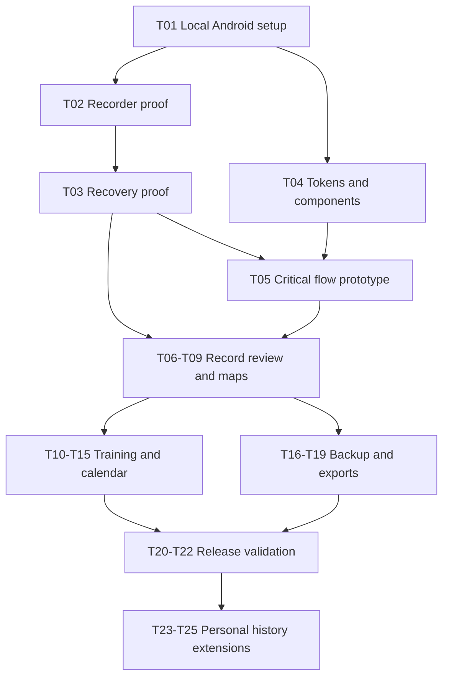

# Running Tracker App Implementation Plan

Baseline: 24 October 2026. Status: proposed. Tasks are tracked in [todo.md](todo.md); no application work is marked complete.

## Outcome and constraints

Build a personal Android app with reliable GPS capture, local history, generated and adaptive plans, workout guidance, calendar publication, maps, share images and recoverable backups. Use existing hardware with zero additional spending. Release two adds personal heatmaps, GPX import and shoe mileage.

The full contracts and behavior are in [system architecture](../docs/system-architecture.md); visual and interaction specifications are in [design system](../docs/design-system.md).

## Architecture decisions

- Kotlin and Jetpack Compose for one Android platform.
- One app module organized by features, plus a pure Kotlin coach module.
- Room is authoritative; DataStore stores preferences. No hosted backend or login.
- A location foreground service owns recording; UI lifecycle never owns capture.
- Deterministic, versioned coach proposals require review and preserve manual edits.
- Android calendar, voice, sharing and file capabilities handle integrations.
- MapLibre Native and OpenFreeMap provide basemaps with attribution and bounded downloads.
- Strava is a manual GPX export/upload flow; no paid developer access is assumed.

## Delivery sequence

| Milestone | Tasks | Dependencies | Exit evidence |
| --- | --- | --- | --- |
| M0 Device proof | T01-T03 | None | Installable prototype; durable locked-screen capture and interruption recovery on target phone |
| M1 Design foundation | T04-T05 | T01; recording findings from T02-T03 | Editable Figma tokens/components, both themes and reviewed critical flows |
| M2 Record and review | T06-T09 | M0 plus M1 | Full run, metrics, history, map and favorite route flow |
| M3 Train and schedule | T10-T15 | M2 | Programs, generator, guidance, reviewed adaptations and calendar reconciliation |
| M4 Protect and share | T16-T19 | M2; calendar where applicable | Restorable backup, alpha PNG, photo share and manual Strava export |
| M5 Personal release | T20-T22 | M3-M4 | Accessibility, battery, reliability and migration evidence; signed private APK |
| M6 Following release | T23-T25 | M5 | Personal heatmap, duplicate-safe import and consistent shoe mileage |

## Dependency graph

## Verification policy

Each task includes focused acceptance checks and a physical-device scenario where platform behavior matters. Once implementation exists, use local `gradlew.bat testDebugUnitTest`, `gradlew.bat lintDebug` and `gradlew.bat assembleDebug`; run `gradlew.bat connectedDebugAndroidTest` on the target device for applicable instrumentation. These commands are planned, not executed test results.

Before using the app as sole recorder, complete three 60-minute locked-screen outdoor sessions and the interruption/recovery matrix. Compare replay metrics with independent fixture calculations. Record actual battery and GPS observations rather than asserting accuracy from another app alone.

Before coach progression is enabled, test all invariants and observe proposals over two weeks. The engine never auto-applies changes afterward either. There is no injury-prevention or race-improvement guarantee.

## Release and rollback

Build and sideload a locally signed APK. Keep the signing key and its backup outside version control. Test every Room migration and a full backup restore before installing a schema-changing release. Use settings gates for experimental coach suggestions and map downloads. Rollback involving an older incompatible schema uses a validated prior backup; do not assume an APK downgrade restores data compatibility.

## Risks and bounded decisions

Recording and recovery are the first technical gate. If A54 background behavior is unreliable, resolve it before expanding the app. If calendar permission is denied, retain the in-app plan and ICS fallback. If map resources fail, show route-only geometry. Missing feedback holds progression. No provider outage blocks saving a local activity.

The design reference needs inspection during Figma authoring, and implementation dependencies must be pinned as a compatible stable set at bootstrap. No public release date or untested schedule estimate is committed.
